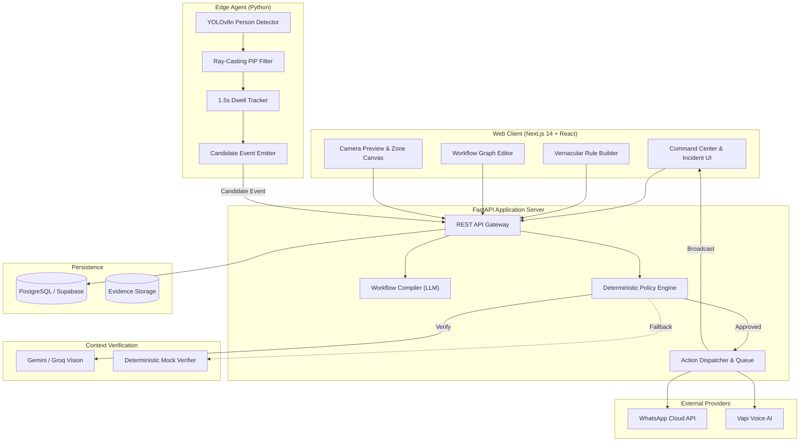

# DrishtiFlow — Event-Aware Edge Vision Intelligence Platform for Bharat Sites

[Build with Bharat 5.0 — Hackathon Prototype • Milestone R0](plan/ROADMAP.md)

> Real-time vision intelligence for warehouse, retail, and edge sites across Bharat. Compile vernacular rules in Hindi/Hinglish/English, verify incidents with contextual VLM, and dispatch idempotent alerts via WhatsApp & voice — all with safe deterministic degradation.

---

## Table of Contents

1. [Overview](#overview)
2. [Architecture](#architecture)
3. [System Flows](#system-flows)
4. [Tech Stack](#tech-stack)
5. [Directory Structure](#directory-structure)
6. [Installation & Setup](#installation--setup)
7. [How to Run](#how-to-run)
8. [API Endpoints](#api-endpoints)
9. [Testing](#testing)
10. [Team & Ownership](#team--ownership)
12. [Security & Safety](#security--safety)
13. [Roadmap (R0 → R4)](#roadmap-r0--r4)
14. [License](#license)

---

## Overview

**DrishtiFlow** is an event-aware edge vision intelligence platform designed for Bharat sites (warehouses, godowns, retail outlets, MSMEs). It enables non-technical users to define monitoring rules in their native language (Hindi, Hinglish, English), deploy them across cameras, verify detections contextually, and trigger safe, idempotent actions.

### Core Value Props
- **Vernacular rule compilation:** "agar koi insaan zone me aaye to WhatsApp bhej do" → structured workflow JSON.
- **Edge vision:** YOLOv8n person detection + ray-casting polygon zone-in-polygon (PiP) + 1.5s dwell tracking.
- **Contextual verification:** 5-state VLM decision engine (`confirmed` / `not_confirmed` / `uncertain` / `needs_human_review` / `processing_failed`) with deterministic mock fallback.
- **Deterministic policy:** Cooldown (60s), camera-scoped rate limit (5/hr), schedule windows.
- **Idempotent actions:** SHA-256 keys prevent duplicate WhatsApp / voice alerts.
- **Shoplifting log:** Entry/exit tracking with shelf-interaction theft suspicion and evidence photos.

---

## Architecture



### Core Subsystems

| Subsystem | Responsibility |
|-----------|---------------|
| **Workflow Compiler** | Converts Hindi/Hinglish/English prompts into schema-valid workflow definitions. Returns `needs_review` with clarification questions for ambiguous inputs. |
| **Video Ingestion** | Webcam / sample clip / RTSP gateway / local agent. No continuous cloud upload — only keyframe snapshots for verification. |
| **Edge Vision Runtime** | YOLOv8n detector (~39ms/frame CPU, ~27 FPS) + normalized coordinate PiP + temporal debounce. |
| **Context Verifier** | 5-state decision engine with cloud VLM + deterministic mock fallback for offline demos. |
| **Policy Engine** | Cooldown suppression, camera-scoped rate limiting, schedule windows, action gating. |
| **Action Dispatcher** | Idempotent queue with SHA-256 keys; WhatsApp, voice call, dashboard alert, local siren adapters. |
| **Shoplifting Monitor** | Person entry/exit tracking, shelf-interaction theft suspicion, single evidence photo per incident, pandas CSV log. |

### Database Schema (PostgreSQL / Supabase)

Key tables: `organizations`, `sites`, `cameras`, `zones`, `workflows`, `workflow_versions`, `incidents`, `actions`, `feedback`. Multi-tenant scoped by `organization_id` / `site_id`. Full DDL in `plan/ARCHITECTURE.md §3`.

---

## System Flows

### Flow 1: End-to-End Event Pipeline (Rule → Detect → Verify → Act)

```
Hindi/Hinglish Prompt
    ↓
Workflow Compiler (LLM)
    ↓
Validate & Activate (user review)
    ↓
Camera + Zone Configuration
    ↓
Edge: YOLOv8n Person Detection
    ↓
Ray-Casting Point-in-Polygon (zone filter)
    ↓
1.5s Dwell Persistence
    ↓
Candidate Event Envelope (signed)
    ↓
Context VLM Verification (5-state decision)
    ↓
Deterministic Policy (cooldown / rate / schedule)
    ↓
Idempotent Action Dispatch (WhatsApp / Voice / Dashboard)
    ↓
Incident Record + Operator Feedback
```

### Flow 2: Shoplifting Detection & Evidence Log

```
Real CCTV / Sample Video
    ↓
YOLOv8n Person Detection per Frame
    ↓
Shop Zone PiP Filter
    ↓
Person Track (IoU-based matching)
    ↓
Entry Time Stamp (zone entry)
    ↓
Shelf Zone Interaction Flag
    ↓
Exit Time Stamp (zone exit / disappear)
    ↓
Theft Heuristic: shelf_interaction AND exited → theft_suspected=True
    ↓
One Evidence Photo (person crop JPEG)
    ↓
Append Row to shop_theft_log.csv (pandas DataFrame)
    ↓
Expose via GET /api/v1/shoplifting/log
    ↓
Shoplifting Log UI Tab (track id, entry, exit, duration, theft flag, photo)
```

---

## Tech Stack

| Layer | Technology |
|-------|-----------|
| **Frontend** | Next.js 14, React, TypeScript, Tailwind CSS, Lucide icons |
| **Backend** | FastAPI, Pydantic v2, Uvicorn |
| **Database** | SQLite (demo) / PostgreSQL / Supabase (production) |
| **Edge Vision** | Python, OpenCV, Ultralytics YOLOv8n, NumPy |
| **AI / VLM** | Gemini / Groq Vision (cloud), Deterministic mock (offline) |
| **Notifications** | WhatsApp Cloud API, Vapi Voice |
| **Testing** | pytest (37+ tests), Next.js ESLint |
| **Package Manager** | npm workspaces (monorepo) |

---

## Directory Structure

```
Build_with_Bharat/
├── apps/
│   └── web/                      # Next.js 14 frontend
│       ├── src/app/              # App router (page, layout, globals)
│       └── src/components/
│           ├── camera/           # CameraPreview, ZoneCanvas
│           ├── workflow/         # RuleBuilder, WorkflowGraph
│           └── incidents/        # IncidentFeed, ActionTester, ShopliftingLog
├── packages/
│   ├── shared-types/             # TypeScript domain types
│   └── workflow-schema/          # Zod schemas for workflows/triggers/actions
├── services/
│   ├── api/                      # FastAPI backend
│   │   ├── app/
│   │   │   ├── main.py           # Gateway server
│   │   │   ├── database.py       # SQLite/PostgreSQL store
│   │   │   ├── routers/          # Health, workflows, cameras, events, incidents, actions, shoplifting
│   │   │   ├── schemas/          # Pydantic models
│   │   │   └── services/         # Compiler, verifier, policy, action_dispatcher
│   │   └── tests/                # pytest suites (37+ tests)
│   └── edge-agent/               # Python edge agent
│       ├── inference/            # YOLOv8n detector
│       ├── ingest/               # Stream handler
│       ├── tracking/             # Dwell tracker, ShopliftMonitor
│       ├── events/               # Candidate event emitter
│       ├── tests/                # pytest suites
│       └── tools/                # run_real_video_pipeline, run_shoplift_pipeline
├── plan/                         # Governance (AGENTS.md protocol)
│   ├── STATE.md, TASKS.md, CHANGELOG.md, ARCHITECTURE.md, ROADMAP.md
├── INSTALL.md                    # Step-by-step initiation guide
├── .env.example                  # Environment configuration template
├── package.json                  # Monorepo root (npm workspaces)
└── README.md                     # This file
```

---

## Installation & Setup

### Prerequisites
- Python 3.10+
- Node.js 18+
- npm 9+
- Git

### 1. Clone
```bash
git clone https://github.com/farhanmallik05/drishtiflow.git
cd drishtiflow
```

### 2. Environment
```bash
copy .env.example .env   # Windows
cp .env.example .env     # macOS/Linux
```
Edit `.env` — ensure `NEXT_PUBLIC_API_URL=http://localhost:8000` is set. Fill in real keys for Gemini/Groq, Vapi, WhatsApp if available (demo falls back to safe mocks).

### 3. Python Backend
```bash
python -m venv .venv
.venv\Scripts\Activate.ps1      # Windows
source .venv/bin/activate       # macOS/Linux
pip install -r services/api/requirements.txt
pip install ultralytics opencv-python numpy yt-dlp pandas python-multipart
```

### 4. Frontend
```bash
npm install
```

---

## How to Run

### Terminal 1 — Backend (port 8000)
```powershell
.venv\Scripts\Activate.ps1
cd services\api
python -m uvicorn app.main:app --port 8000 --reload
```

### Terminal 2 — Frontend (port 3000)
```powershell
npm run dev:web
```

### Verify
```powershell
curl.exe -s http://localhost:8000/api/v1/health
# → {"status":"healthy","service":"drishtiflow-api","version":"3.0.0",...}
```

### Open
🔗 **http://localhost:3000**

### Run Real YOLO Pipeline on CCTV Footage
```bash
python services/edge-agent/tools/run_real_video_pipeline.py
```

---

## API Endpoints

| Method | Route | Description |
|--------|-------|-------------|
| `GET` | `/api/v1/health` | Service liveness |
| `GET` | `/api/v1/ready` | Dependency readiness |
| `POST` | `/api/v1/workflows/compile` | Compile vernacular prompt → workflow |
| `GET/POST` | `/api/v1/workflows` | List / create workflows |
| `POST` | `/api/v1/workflows/{id}/activate` | Activate workflow version |
| `POST` | `/api/v1/workflows/{id}/pause` | Pause workflow |
| `GET/POST` | `/api/v1/cameras` | List / register cameras |
| `POST` | `/api/v1/cameras/{id}/zones` | Add polygon zone |
| `POST` | `/api/v1/events/candidates` | Ingest candidate edge event |
| `POST` | `/api/v1/incidents/{id}/verify` | Trigger VLM verification |
| `GET` | `/api/v1/incidents` | Query incident history |
| `POST` | `/api/v1/incidents/{id}/acknowledge` | Acknowledge incident |
| `POST` | `/api/v1/incidents/{id}/feedback` | Submit operator feedback |
| `POST` | `/api/v1/actions/test` | Dispatch test WhatsApp / voice |
| `GET` | `/api/v1/shoplifting/log` | Shoplifting log (CSV-backed) |
| `GET` | `/api/v1/shoplifting/evidence/{file}` | Serve evidence photo |
| `POST` | `/api/v1/shoplifting/upload-video` | Upload video file |
| `POST` | `/api/v1/shoplifting/process-video` | Run YOLO + shoplifting pipeline |
| `GET` | `/api/v1/shoplifting/videos/{file}` | Serve uploaded video |

---

## Testing

```bash
# Backend + edge agent tests (48 tests)
pytest services/api/tests services/edge-agent/tests -q

# Frontend lint
npm run lint --workspace=apps/web

# Frontend production build
npm run build --workspace=apps/web
```

### Test Coverage
- **47+ tests passing** across API and edge-agent suites
- Compiler (Hindi/English), health, policy/stress, boundary challenges, evaluation harness (100% precision/recall), e2e pipeline, edge geometry, YOLO detector, shoplifting monitor, legacy resilience regression

---

## Team & Ownership

| Track | Owner | Focus |
|-------|-------|-------|
| Track 0: Project Setup & Plan System | Farhan | Plan system, PFCP protocol, release coordination |
| Track 1: Monorepo & Shared Schemas | Farhan | FastAPI backend, Zod/Pydantic contracts |
| Track 2: Camera Ingestion & Edge Vision | Kartikey | Webcam/sample, ZoneCanvas PiP, YOLOv8n edge |
| Track 3: Context Verification Engine | Ankit | VLM verifier, deterministic mock, test harness |
| Track 4: Frontend, Canvas & Incident UI | Piyush | Next.js Command Center, RuleBuilder, Graph, Shoplifting Log |
| Track 5: Policy Engine & Action Worker | Kaushendra | Cooldown policy, WhatsApp & Vapi adapters |
| Track 6: Testing, Evaluation & Pitch | All | 48 tests, evaluation harness, pitch rehearsal |

---

## Security & Safety

- **No secrets in frontend** — all API keys are backend-only environment variables.
- **Data minimization** — no continuous video upload to cloud; only triggered keyframe snapshots.
- **Tenant isolation** — every DB query scoped by `organization_id`.
- **Idempotency** — SHA-256 keys prevent duplicate WhatsApp / voice alerts.
- **Safe degradation** — VLM failures degrade to `uncertain` / `processing_failed`, never silently suppressed.
- **Human-in-the-loop** — high-consequence actions require explicit opt-in; no autonomous emergency dispatch.

---

## Roadmap (R0 → R4)

| Milestone | Scope | Status |
|-----------|-------|--------|
| **R0: Hackathon Prototype** | Single camera, Hindi compiler, zone trigger, VLM verify, test WhatsApp/voice | ✅ Complete |
| **R1: Supervised Pilot MVP** | Multi-camera, auth, retries, audit trail, Supabase DB, RTSP agent | ⬜ Upcoming |
| **R2: Multi-Site Operations** | Org/site hierarchy, RBAC, retention policies, quotas | ⬜ Upcoming |
| **R3: Enterprise Integrations** | Webhooks, NVR/DVR bridges, device heartbeat telemetry | ⬜ Upcoming |
| **R4: Advanced Intelligence** | Fine-tuned models (PPE, fall detection, smoke), model governance | ⬜ Upcoming |

Full milestone breakdown in `plan/ROADMAP.md`.

---

## License

Build with Bharat 5.0 Hackathon Project.

---

*Governed by `plan/PLAN_RULE.md` (Plan-First Change Protocol). All code changes must be accompanied by updates to `plan/STATE.md`, `plan/TASKS.md`, `plan/CHANGELOG.md`, `plan/ARCHITECTURE.md`, and `plan/ROADMAP.md`.*
