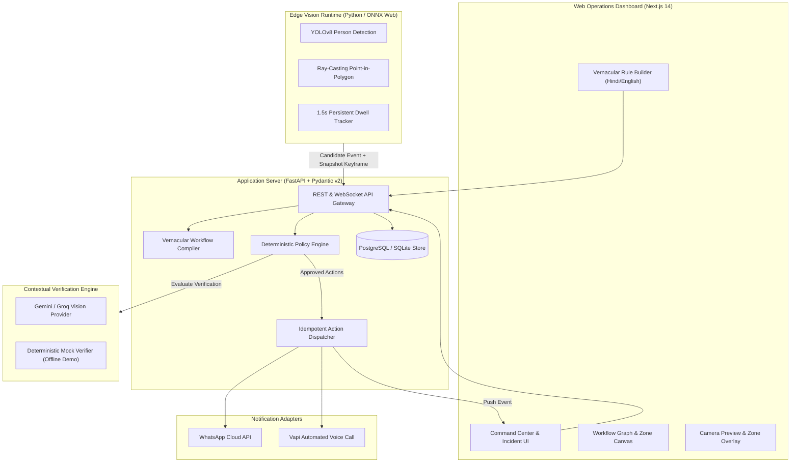

# DrishtiFlow (दृष्टि-फ़्लो)
### Turn existing cameras into configurable, event-aware safety and operations systems.

> **Prepared for Build with Bharat 5.0**  
> **Primary Wedge:** Warehouse, godown, and MSME perimeter after-hours restricted zone monitoring.  
> **Core Principle:** Configure in a local language. Detect near the camera. Verify with contextual AI. Keep a deterministic policy and human in control.

---

## 🎯 The Problem

Indian MSMEs, warehouses, and logistics hubs have millions of passive CCTV cameras that record passively onto DVRs/NVRs. Frontline operators face four critical problems:
1. **Passive Recording Blindness:** Events are noticed hours or days too late when reviewing footage.
2. **Motion-Alert Fatigue:** Basic pixel-motion sensors spam operators with false alarms from headlights, shadows, bugs, and rain.
3. **Prohibitive Cloud Streaming Costs:** Uploading 24/7 continuous video streams to cloud analytics exhausts bandwidth and incurs catastrophic computing bills.
4. **Technical Complexity:** Frontline site managers need local-language, vernacular configuration rather than complex enterprise video analytics software.

---

## 💡 The Solution: Edge-First, Policy-Governed Vision Automation

DrishtiFlow decouples video capture, perception, semantic reasoning, and deterministic policy execution into a unified platform:



---

## ✨ Key Features

### 1. Vernacular Rule Builder (भाषा आधारित नियम)
- Configure monitoring in spoken or typed **Hindi, Hinglish, or English**:
  > *"Raat 10 baje ke baad godown mein koi aaye toh alert karo"*
- The compiler maps instructions to a strict, typed **Trigger → Verify → Action** workflow schema, setting schedule hours (`22:00–06:00`), target classes (`person`), and clarification questions for unconfigured zones.
- Includes pre-built **Bharat Presets**:
  - Mandi & Godown After-Hours Security
  - MSME Restricted Machinery Zone
  - Hospital Possible-Fall Assist
  - Kirana Counter Security

### 2. Geometric Ray-Casting Zone of Interest
- Interactive polygon drawing overlay directly on video feeds with normalized coordinates `(0.0 to 1.0)`.
- Evaluates the bottom-center anchor point of bounding boxes using the **Ray-Casting Point-in-Polygon (PIP)** algorithm.
- Movement outside the zone is completely ignored.

### 3. Edge-First Candidate Ingestion & 1.5s Dwell Persistence
- **Zero continuous cloud video upload:** Video frames stay strictly local near the camera source.
- Bounded 1.5-second temporal dwell tracking filters out transient flickers, headlight sweeps, or people walking along the boundary edge. Only persistent presence triggers an escalation.

### 4. Contextual VLM Verification (5-State Contract)
- Escalates a single snapshot keyframe to a Vision-Language Model (VLM) for contextual reasoning against the rule instructions.
- Enforces a 5-state decision model:
  - `confirmed`: Clear evidence of breach.
  - `not_confirmed`: False trigger (shadow, glare, animal).
  - `uncertain`: Visual ambiguity (blur, partial occlusion).
  - `needs_human_review`: Operator intervention required.
  - `processing_failed`: Provider timeout safely degraded (never treated as safe).
- An explicitly selected `VISION_PROVIDER=mock` mode supports offline demonstrations. It reports deterministic mock provenance and must not be represented as live visual verification.

### 5. Deterministic Policy Engine & Idempotent Actions
- **AI never triggers alarms directly.** Code decides:
  - **Schedule Guard:** Verifies wall-clock time in site timezone (`Asia/Kolkata`).
  - **Cooldown Suppression:** Enforces a 60-second cooldown between repeated alerts on the same camera.
  - **Rate Limiting:** Maximum 5 actions/camera/hour.
- **Idempotency:** SHA-256 idempotency keys prevent duplicate notification storms during network retries.
- Dispatches multi-channel alerts: **Realtime Command Center**, **WhatsApp Cloud API**, and **Vapi Outbound Phone Calls**.

---

## 🏗️ Repository Architecture

```text
drishtiflow/
├── apps/
│   └── web/                   # Next.js 14 App Router, Tailwind CSS, Canvas PIP, Incident Feed
├── services/
│   ├── api/                   # FastAPI backend, Pydantic schemas, Compiler, Verifier, Policy Engine
│   └── edge-agent/            # Python stream ingestion, Ray-casting PIP, 1.5s dwell tracker
├── packages/
│   ├── workflow-schema/       # Shared Zod schemas & TypeScript types
│   └── shared-types/          # Domain entity interfaces
├── plan/                      # Single Source of Truth (PFCP Plan System)
│   ├── STATE.md               # Real-time state machine & telemetry
│   ├── ROADMAP.md             # Milestone-based roadmap (R0 to R4)
│   ├── ARCHITECTURE.md        # Technical architecture & DB schema
│   ├── TASKS.md               # 27/27 completed tasks with evidence
│   └── STANDARDS.md           # Definition of Done & quality gates
├── .env.example               # Configuration template
├── package.json               # Root npm workspace
└── README.md
```

---

## 🚀 Quickstart Guide

### Prerequisites
- **Node.js**: v18+ (tested on v24)
- **Python**: 3.10+ (tested on 3.13)
- **Git**

### 1. Clone & Install
```bash
# Install Node workspace dependencies
npm install

# Install Python backend dependencies
cd services/api
pip install -r requirements.txt
cd ../..
```

### 2. Environment Configuration
```bash
cp .env.example .env
```
*(The default configuration runs out-of-the-box with local SQLite and deterministic offline mock verification mode for zero-dependency local testing).*

### 3. Run Backend API
```bash
python -m uvicorn services.api.app.main:app --reload --port 8000
```
- API Docs: `http://localhost:8000/docs`
- Health Probe: `http://localhost:8000/api/v1/health`

### 4. Run Frontend Dashboard
```bash
npm run dev --workspace=apps/web
```
- Open `http://localhost:3000` in your browser.

---

## 🧪 Testing & Validation Evidence

Run offline unit and API tests (real provider calls are excluded by default):

```bash
python -m pytest services/api/tests services/edge-agent/tests

# Run the separately marked Groq/Gemini provider integration tests.
# This sends requests to configured external services and may incur charges.
python -m pytest -m integration services/api/tests/test_groq_compiler.py services/api/tests/test_gemini_verifier.py

# Run frontend linting & production build
npm run lint --workspace=apps/web
npm run build --workspace=apps/web
```

### Verification status (2026-11-05)

- Frontend lint passed with no warnings or errors.
- Frontend production build completed successfully; Next.js generated the static routes.
- Python tests were not run in the current workspace because no Python runtime is installed.
- The synthetic image fixtures are checked for valid image encoding only. No real-world precision, recall, false-positive rate, or monitoring latency claim is made here.
- Physical camera, live provider delivery, and 30-minute monitoring acceptance tests still require their external hardware and credentials.

---

## 🛡️ Responsible AI & DPDP Act Alignment

- **No Facial Recognition:** Biometric identification, emotion detection, and demographic profiling are strictly prohibited.
- **Data Minimization:** No continuous video recording is transmitted to cloud storage. Only event snapshots are stored with configurable retention policies.
- **Assistive Technology:** DrishtiFlow is an assistive notification layer, never an autonomous emergency dispatcher.
- **Fail-Safe Degradation:** Model timeouts or ambiguities degrade safely to `uncertain` or `processing_failed`, never silently suppressed.

---

## 📜 License

MIT License. Built with pride for **Build with Bharat 5.0**.

