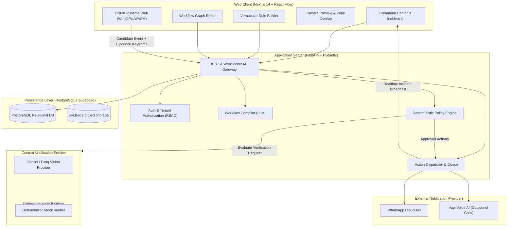

# DrishtiFlow System Architecture & Technical Specification
**Version:** 3.0  
**Target:** Build with Bharat 5.0  
**Governing Document:** [DrishtiFlow_Enhanced_PRD_v3_EMPTY.md](file:///d:/hackathon/Build%20with%20Bharat/DrishtiFlow_Enhanced_PRD_v3_EMPTY.md) §6, §7, §8, §9

---

## 1. High-Level Architecture Topology



---

## 2. Core Subsystems

### 2.1 Vernacular Workflow Compiler
- **Function:** Translates conversational Hindi, Hinglish, or English into structured, schema-valid JSON workflows.
- **Model:** Fast reasoning LLM (Gemini 1.5 Flash / Groq Llama 3) with constrained decoding.
- **Output Schema:** `WorkflowDefinitionSchema` (v1.0).
- **Security & Safety Rules:**
  1. User input is treated strictly as data, never prompt instructions (prompt injection defense).
  2. Classes, actions, and condition operators are validated against explicit allowlists.
  3. Never hallucinates camera IDs, recipient phone numbers, or active schedules.
  4. Returns `needs_review` status whenever critical operational parameters are omitted.
  5. Workflow activation is strictly gated by explicit user review; generated workflows are NEVER auto-activated.

#### Compiler Allowlist:
- **Detector Classes:** `person`, `vehicle`, `car`, `truck`, `motorcycle`, `animal`.
- **Condition Types:** `object_in_zone`, `schedule_match`, `dwell_time_exceeded`.
- **Action Types:** `dashboard_alert`, `whatsapp_message`, `voice_call`, `local_siren`.

---

### 2.2 Video Ingestion & Camera Gateway
- **Input Sources:**
  - `webcam`: Direct browser capture via `navigator.mediaDevices.getUserMedia` (MVP primary).
  - `sample`: Pre-loaded test video streams (warehouse restricted zone, daytime operation) for reliable demonstrations.
  - `webrtc_gateway`: IP camera bridge converting RTSP feeds to low-latency WebRTC streams (Phase 2).
  - `local_agent`: Dedicated background daemon for 24/7 site monitoring without browser dependency.
- **Privacy Controls:**
  - No continuous video is uploaded to the cloud.
  - Video stays local on the client/edge machine. Only verified candidate keyframes (snapshots) are transmitted for context verification upon detection.

---

### 2.3 Edge Vision Runtime
- **Runtime:** ONNX Runtime Web utilizing WebGPU acceleration with automatic CPU/WASM fallback.
- **Detection Model:** YOLOv8n / YOLOv11n (COCO-pretrained person detection, input resolution 640x640 or 320x320).
- **Geometric Zone Engine:**
  - Normalized coordinate system `(x: 0.0 - 1.0, y: 0.0 - 1.0)`.
  - Point-in-polygon test: Ray-casting algorithm evaluating the bottom-center point of the object's bounding box `(x_center, y_bottom)` against the defined polygon vertices.
- **Temporal Debounce:**
  - Candidate event is triggered only if the detected object resides within the restricted zone for more than a configured threshold (e.g. 1.5 seconds / 4 consecutive frames).
  - Prevents alert flicker at perimeter boundaries.

---

### 2.4 Contextual Verification Engine
- **Function:** Evaluates candidate event keyframes against the rule's specific semantic verification instructions.
- **Contract:** Schema-validated output returning one of five canonical states:
  - `confirmed`: Clear evidence that the rule condition is breached.
  - `not_confirmed`: Event verified as false candidate (e.g. shadow, reflection, outside zone).
  - `uncertain`: Insufficient visual evidence (blur, occlusion, extreme distance).
  - `needs_human_review`: Edge case requiring operator sign-off before escalation.
  - `processing_failed`: Provider error, timeout, or schema failure.
- **Safety Policy:** Provider timeout or schema failure NEVER resolves to `safe` or `confirmed`. It safely degrades to `uncertain` / `processing_failed`.
- **Offline Fallback:** Deterministic local mock verifier pre-trained on the demonstration test clips to ensure zero-risk live presentations if internet connectivity fails.

---

### 2.5 Deterministic Policy Engine
- **Purpose:** Decouples AI perception from action execution. The AI classifies; the deterministic policy engine decides whether an action is permitted.
- **Policy Rules:**
  - **Cooldown Suppression:** Enforces a minimum interval (default: 60s) between repeated alerts for the same zone/object.
  - **Rate Limiting:** Maximum actions per hour (default: 5 actions/hour) per camera.
  - **Schedule Guard:** Verifies current wall-clock time against the configured timezone schedule (e.g. Asia/Kolkata 22:00–06:00).
  - **Action Gating:** High-consequence actions (outbound voice call, sirens) require explicit user opt-in and verified recipient configuration.

---

### 2.6 Action Dispatcher & Notification Worker
- **Execution Model:** Asynchronous worker processing an idempotent action queue.
- **Idempotency:** Every action generates an idempotency key:
  `hash(incident_id, action_type, recipient_id, attempt_window)`
  Guarantees that retry storms never cause duplicate WhatsApp messages or phone calls.
- **Adapters:**
  - **Dashboard:** WebSocket / Realtime push update to browser Command Center.
  - **WhatsApp Cloud API:** Sends template-compliant WhatsApp notification with incident timestamp, camera name, and snapshot evidence URL.
  - **Vapi Voice Engine:** Initiates an automated phone call with text-to-speech summary and prompt for keypress acknowledgment.

---

## 3. Database Schema Specification (PostgreSQL / Supabase)

```sql
-- Extensions
create extension if not exists "pgcrypto";

-- Organizations & Multi-Tenancy
create table organizations (
    id uuid primary key default gen_random_uuid(),
    name text not null,
    slug text not null unique,
    created_at timestamptz not null default now()
);

create table sites (
    id uuid primary key default gen_random_uuid(),
    organization_id uuid not null references organizations(id) on delete cascade,
    name text not null,
    timezone text not null default 'Asia/Kolkata',
    created_at timestamptz not null default now()
);

-- Cameras & Zones
create table cameras (
    id uuid primary key default gen_random_uuid(),
    organization_id uuid not null references organizations(id) on delete cascade,
    site_id uuid not null references sites(id) on delete cascade,
    name text not null,
    source_type text not null check (source_type in ('webcam', 'webrtc_gateway', 'local_agent', 'sample')),
    stream_url text,
    credential_ref text,
    status text not null default 'pending' check (status in ('pending', 'online', 'degraded', 'offline')),
    last_heartbeat_at timestamptz,
    created_at timestamptz not null default now()
);

create table zones (
    id uuid primary key default gen_random_uuid(),
    camera_id uuid not null references cameras(id) on delete cascade,
    name text not null,
    polygon jsonb not null, -- Array of {x: float, y: float} (0.0 to 1.0)
    color text default '#ef4444',
    created_at timestamptz not null default now()
);

-- Workflows & Versions
create table workflows (
    id uuid primary key default gen_random_uuid(),
    organization_id uuid not null references organizations(id) on delete cascade,
    site_id uuid not null references sites(id) on delete cascade,
    camera_id uuid references cameras(id) on delete set null,
    name text not null,
    active_version integer,
    status text not null default 'draft' check (status in ('draft', 'active', 'paused', 'archived')),
    created_at timestamptz not null default now(),
    updated_at timestamptz not null default now()
);

create table workflow_versions (
    id uuid primary key default gen_random_uuid(),
    workflow_id uuid not null references workflows(id) on delete cascade,
    version integer not null,
    schema_version text not null default '1.0',
    definition jsonb not null,
    compiler_model text,
    prompt_version text,
    created_at timestamptz not null default now(),
    unique(workflow_id, version)
);

-- Incidents & Evidence
create table incidents (
    id uuid primary key default gen_random_uuid(),
    organization_id uuid not null references organizations(id) on delete cascade,
    site_id uuid not null references sites(id) on delete cascade,
    camera_id uuid not null references cameras(id) on delete cascade,
    workflow_id uuid references workflows(id) on delete set null,
    workflow_version integer,
    event_type text not null,
    status text not null check (status in (
        'candidate', 'verifying', 'confirmed', 'not_confirmed',
        'uncertain', 'action_pending', 'action_sent', 'action_failed',
        'acknowledged', 'resolved'
    )),
    detector_confidence real,
    verifier_confidence real,
    evidence_url text,
    reason text,
    occurred_at timestamptz not null,
    created_at timestamptz not null default now()
);

-- Actions & Retries
create table actions (
    id uuid primary key default gen_random_uuid(),
    incident_id uuid not null references incidents(id) on delete cascade,
    action_type text not null check (action_type in ('dashboard_alert', 'whatsapp_message', 'voice_call', 'local_siren')),
    status text not null default 'queued' check (status in ('queued', 'sent', 'delivered', 'failed', 'suppressed')),
    idempotency_key text not null unique,
    recipient_ref text,
    provider_reference text,
    attempts integer not null default 0,
    last_error text,
    created_at timestamptz not null default now(),
    updated_at timestamptz not null default now()
);

-- Human Feedback for Continuous Evaluation
create table feedback (
    id uuid primary key default gen_random_uuid(),
    incident_id uuid not null references incidents(id) on delete cascade,
    label text not null check (label in (
        'true_positive', 'false_positive', 'missed_event_report',
        'uncertain', 'poor_evidence', 'wrong_zone', 'wrong_rule'
    )),
    note text,
    created_by text,
    created_at timestamptz not null default now()
);

-- Performance Indexes
create index idx_incidents_org_time on incidents (organization_id, occurred_at desc);
create index idx_incidents_camera_time on incidents (camera_id, occurred_at desc);
create index idx_actions_status on actions (status, created_at);
create index idx_cameras_site on cameras (site_id);
```

---

## 4. API Endpoints Specification

| Method | Route | Description |
|---|---|---|
| `GET` | `/api/v1/health` | Service liveness check |
| `GET` | `/api/v1/ready` | Dependency readiness (DB, VLM, action services) |
| `POST` | `/api/v1/workflows/compile` | Compile Hindi/English input into structured draft workflow |
| `GET` | `/api/v1/workflows` | List workflows for current organization |
| `POST` | `/api/v1/workflows` | Save new draft workflow |
| `POST` | `/api/v1/workflows/{id}/activate` | Validate and activate workflow version |
| `POST` | `/api/v1/workflows/{id}/pause` | Pause active monitoring for a workflow |
| `GET` | `/api/v1/cameras` | List configured cameras with live status |
| `POST` | `/api/v1/cameras` | Register a new camera stream or sample clip |
| `POST` | `/api/v1/events/candidates` | Ingest candidate event from edge detector |
| `POST` | `/api/v1/incidents/{id}/verify` | Trigger contextual VLM verification |
| `GET` | `/api/v1/incidents` | Query incident history with filtering & pagination |
| `POST` | `/api/v1/incidents/{id}/acknowledge` | Mark an incident as acknowledged by operator |
| `POST` | `/api/v1/incidents/{id}/feedback` | Submit operator feedback (True/False Positive) |
| `POST` | `/api/v1/actions/test` | Dispatch a safe test notification to verified destination |

---

## 5. Security & Privacy Boundaries

1. **Zero Secrets in Frontend:** All API keys (`GROQ_API_KEY`, `VISION_API_KEY`, `WHATSAPP_ACCESS_TOKEN`, `VAPI_API_KEY`) reside exclusively in backend environment variables.
2. **Data Minimization:** No continuous video stream is transmitted to cloud storage. Only keyframes from triggered candidate events are stored for verification and auditing.
3. **Tenant Isolation:** Every database query enforces `organization_id` scoping.
4. **Idempotency Guarantees:** Actions cannot be duplicated by retries or race conditions due to unique database idempotency constraints.
5. **Human-in-the-Loop:** Safety-critical actions require human review. High-consequence dispatch to public emergency services is explicitly excluded from MVP scope.

