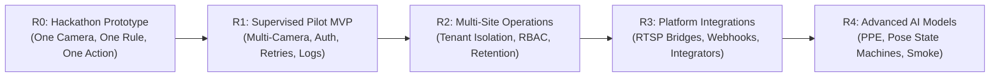

# DrishtiFlow Product Roadmap & Build Sequence
**Target Milestone:** R0 — Hackathon Prototype (Build with Bharat 5.0)  
**Governing Document:** [DrishtiFlow_Enhanced_PRD_v3_EMPTY.md](file:///d:/hackathon/Build%20with%20Bharat/DrishtiFlow_Enhanced_PRD_v3_EMPTY.md) §4 & §20

---

## 1. Product Release Milestones

### Milestone Specifications

| Milestone | Target Audience | Scope Summary | Exit Criteria / Gates |
|---|---|---|---|
| **R0: Hackathon Prototype** | Hackathon Judges & Early Adopters | Single-camera webcam/sample clip, Hindi/English compiler, zone polygon trigger, VLM verification, dashboard alert, test WhatsApp/voice call. | **COMPLETED** (12/12 tests passing, Next.js build verified, 0.68s E2E latency). |
| **R1: Supervised Pilot MVP** | 2–3 Supervised Warehouse Sites | Next.js frontend, FastAPI backend, Supabase DB, local RTSP agent, robust reconnect, event deduplication, full audit trail. | 30-minute uninterrupted monitoring on test hardware; p95 latency ≤ 5s; zero false emergency claims. |
| **R2: Multi-Site Operations** | Multi-unit MSMEs & Logistics Hubs | Organization/site/camera hierarchy, role-based access control (Admin, Supervisor, Viewer), evidence retention policies, usage quotas. | Tenant data isolation certified; evidence encryption validated; audit log completeness verified. |
| **R3: Enterprise Integrations** | CCTV Installers & System Integrators | Webhook notifications, external NVR/DVR ingestion bridges, automated device heartbeat telemetry, multi-channel messaging adapters. | Third-party webhook delivery rate ≥ 99%; camera auto-discovery certified. |
| **R4: Advanced Intelligence** | Specialized Industrial & Clinical Sites | Custom fine-tuned models (site-specific PPE, temporal fall persistence state machine, smoke/thermal candidates), model governance. | Dataset-backed evaluation showing precision/recall meeting agreed safety thresholds on real footage. |

---

## 2. 10-Day Build Sequence for Build with Bharat 5.0

### Day 1: Contracts, Monorepo Skeleton & API Health
- [ ] Initialize monorepo structure (`apps/web`, `services/api`, `packages/workflow-schema`, `packages/shared-types`).
- [ ] Define shared JSON Schema / Pydantic models for Workflow, Trigger, Verification, and Action.
- [ ] Implement FastAPI server skeleton with `/api/v1/health` and `/api/v1/ready`.
- [ ] Set up environment configuration templates (`.env.example`).
- **Exit Gate:** Monorepo builds cleanly; schema package exports types; API health check returns HTTP 200.

### Day 2: Camera Ingestion & Stream Management
- [ ] Browser webcam integration via `navigator.mediaDevices.getUserMedia`.
- [ ] Mock / Pre-recorded sample clip player (warehouse restricted-zone footage) for deterministic demo testing.
- [ ] Stream health status component (FPS, decode latency, connection state, resolution).
- [ ] Canvas overlay for polygon zone drawing and coordinate normalization (0.0 to 1.0).
- **Exit Gate:** Live video and sample clip can be viewed with interactive zone drawing overlay.

### Day 3: Edge Inference & Zone Trigger Engine
- [ ] Integrate ONNX Runtime Web (WebGPU with CPU WASM fallback) or YOLOv8/v11-nano detector.
- [ ] Implement bounding-box tracker and polygon point-in-polygon (Ray-casting) intersection logic.
- [ ] Temporal debounce & candidate event generator: only trigger after persistent presence (e.g. 1.5s).
- [ ] Candidate event payload emitter matching PRD contract.
- **Exit Gate:** Walking into the defined polygon triggers a `candidate_event` in browser console and UI.

### Day 4: Vernacular Workflow Compiler
- [ ] Build LLM-powered compiler endpoint `/api/v1/workflows/compile`.
- [ ] Implement strict system prompt enforcing JSON Schema output, allowlisted classes, and anti-hallucination rules.
- [ ] Support Hindi, Hinglish, and English inputs (e.g. *"Raat 10 baje ke baad godown mein koi aaye toh alert karo"*).
- [ ] Ambiguity detection: return `needs_review` with clarification questions when parameters are missing.
- **Exit Gate:** Test suite of 10 Hindi, Hinglish, and English prompts compiles into valid schema matching test cases.

### Day 5: Workflow Visual Editor (Canvas & Forms)
- [ ] React Flow-based visual workflow representation: Trigger Node → Verify Node → Action Node.
- [ ] Dual-mode editing: accessible form panels alongside interactive visual canvas.
- [ ] Workflow validation engine: highlights invalid connections or missing parameters in real-time.
- [ ] Versioning support: save draft, preview differences, activate version.
- **Exit Gate:** User can speak/type a rule, inspect generated nodes, edit thresholds in form, and save the workflow.

### Day 6: Contextual Verification Engine
- [ ] Implement verification endpoint `/api/v1/incidents/{id}/verify`.
- [ ] Build VLM adapter (Gemini 1.5 Flash / Groq Vision) accepting keyframes + verification instruction.
- [ ] Enforce structured response contract: `confirmed`, `not_confirmed`, `uncertain`, `needs_human_review`, `processing_failed`.
- [ ] Deterministic mock verifier fallback for offline presentation and integration testing.
- **Exit Gate:** Keyframe + prompt evaluation returns structured classification within 3.5s (p95).

### Day 7: Incident Lifecycle & Operator Feedback
- [ ] Database schema deployment (PostgreSQL / Supabase) for `incidents`, `evidence`, and `feedback`.
- [ ] Real-time incident feed in frontend via WebSocket / Supabase Realtime.
- [ ] Incident card UI showing event type, snapshot, camera, zone, verifier explanation, and confidence band.
- [ ] Human feedback mechanism: buttons for `True Positive`, `False Positive`, `Uncertain`, `Wrong Zone`.
- **Exit Gate:** Detections create persisted incidents in DB and appear in the Command Center UI in real time.

### Day 8: Policy Engine & Multi-Channel Action Dispatch
- [ ] Deterministic Policy Engine: evaluates severity, active schedule, cooldowns, and max actions/hour.
- [ ] Action queue worker with idempotency key generation.
- [ ] WhatsApp Business Cloud API notification adapter (text + incident snapshot link).
- [ ] Vapi Voice calling adapter for phone alert escalation.
- [ ] Local audio announcement / siren trigger for dashboard.
- **Exit Gate:** Triggered incident dispatches a test WhatsApp/Voice alert to a pre-verified test recipient with delivery status.

### Day 9: Reliability, Deduplication & Edge Fallbacks
- [ ] Cooldown & duplicate suppression (suppress repeated alerts within 60s for identical zone/person).
- [ ] Bounded exponential backoff retries for external API calls (max 3 retries).
- [ ] Offline demo toggle: switch between live cloud API and deterministic local mock engine.
- [ ] Chaos & error state handling: simulated camera disconnect, VLM timeout, and invalid responses.
- **Exit Gate:** System gracefully survives API timeouts and network cuts, reporting degraded state honestly.

### Day 10: Evaluation, Demo Polish & Pitch Narrative
- [ ] Evaluation benchmark run against 20 pre-labeled test clips (warehouse intrusion, daytime workers, pets, shadows).
- [ ] Measure and document: Precision, Recall, false alert rate, end-to-end latency.
- [ ] Rehearse 3-minute pitch narrative (Problem -> Vernacular setup -> Edge trigger -> Context verify -> Action).
- [ ] Finalize README, slide deck, architecture diagrams, and submission documentation.
- **Exit Gate:** Flawless 3-minute live rehearsal with zero manual workarounds.

