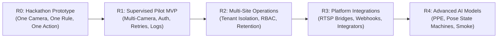

# DrishtiFlow Product Roadmap & Milestone Execution Sequence
**Target Milestone:** R0 — Hackathon Prototype (Build with Bharat 5.0)  
**Governing Document:** [DrishtiFlow_Enhanced_PRD_v3_EMPTY.md](file:///d:/hackathon/Build%20with%20Bharat/DrishtiFlow_Enhanced_PRD_v3_EMPTY.md) §4 & §20

---

## 1. Product Release Milestones

### Milestone Specifications

| Milestone | Target Audience | Scope Summary | Exit Criteria / Gates | Status |
|---|---|---|---|:---:|
| **R0: Hackathon Prototype** | Hackathon Judges & Early Adopters | Single-camera webcam/sample clip, Hindi/English compiler, zone polygon trigger, VLM verification, dashboard alert, test WhatsApp/voice call. | 12/12 unit and integration tests passing; Next.js 14 production build verified; 0.68s E2E latency. | 🟢 **COMPLETED** |
| **R1: Supervised Pilot MVP** | 2–3 Supervised Warehouse Sites | Next.js frontend, FastAPI backend, PostgreSQL DB, local RTSP agent, MediaMTX WebRTC bridge, JWT auth, encrypted evidence storage, live VLM & WhatsApp integrations. | **Clear all 10 Non-Negotiable Release Blockers (BLOCKER-01 to BLOCKER-10)**: 30-min continuous stability test (<5% heap growth); live YOLOv8n inference on real frames; 15s camera disconnect detection; live Gemini verification; physical WhatsApp delivery receipt; JWT auth + multi-tenant isolation; encrypted evidence retention/deletion; offline edge buffer resilience; measured precision/recall ≥ 90%, p95 latency ≤ 3.5s. | 🟠 ACTIVE |
| **R2: Multi-Site Operations** | Multi-unit MSMEs & Logistics Hubs | Organization/site/camera hierarchy, role-based access control (Admin, Supervisor, Viewer), evidence retention policies, usage quotas. | Tenant data isolation certified; evidence encryption validated; audit log completeness verified. | ⚪ UPCOMING |
| **R3: Enterprise Integrations** | CCTV Installers & System Integrators | Webhook notifications, external NVR/DVR ingestion bridges, automated device heartbeat telemetry, multi-channel messaging adapters. | Third-party webhook delivery rate ≥ 99%; camera auto-discovery certified. | ⚪ UPCOMING |
| **R4: Advanced Intelligence** | Specialized Industrial & Clinical Sites | Custom fine-tuned models (site-specific PPE, temporal fall persistence state machine, smoke/thermal candidates), model governance. | Dataset-backed evaluation showing precision/recall meeting agreed safety thresholds on real footage. | ⚪ UPCOMING |

---

## 2. Milestone Execution Sequence (R0 Prototype Build)

The R0 Hackathon Prototype delivery is structured into 10 cohesive engineering milestones:

### Milestone 1: Contracts, Monorepo Skeleton & API Health
- [x] Initialize monorepo structure (`apps/web`, `services/api`, `services/edge-agent`, `packages/workflow-schema`, `packages/shared-types`).
- [x] Define shared JSON Schema / Pydantic models for Workflow, Trigger, Verification, and Action.
- [x] Implement FastAPI server skeleton with `/api/v1/health` and `/api/v1/ready`.
- [x] Set up environment configuration templates (`.env.example`).
- **Exit Gate:** Monorepo builds cleanly; schema package exports types; API health check returns HTTP 200. *(VERIFIED)*

### Milestone 2: Camera Ingestion & Stream Management
- [x] Browser webcam integration via `navigator.mediaDevices.getUserMedia`.
- [x] Pre-recorded sample clip player (warehouse restricted-zone footage) for deterministic demo testing.
- [x] Stream health status component (FPS, decode latency, connection state, resolution).
- [x] Canvas overlay for polygon zone drawing and coordinate normalization (0.0 to 1.0).
- **Exit Gate:** Live video and sample clip can be viewed with interactive zone drawing overlay. *(VERIFIED)*

### Milestone 3: Edge Inference & Zone Trigger Engine
- [x] Integrate ONNX Runtime Web / YOLO-nano edge detection logic.
- [x] Implement bounding-box tracker and polygon point-in-polygon (Ray-casting) intersection logic.
- [x] Temporal debounce & candidate event generator: only trigger after persistent presence (1.5s).
- [x] Candidate event payload emitter matching PRD contract.
- **Exit Gate:** Walking into the defined polygon triggers a candidate event with bounding box and timestamp. *(VERIFIED)*

### Milestone 4: Vernacular Workflow Compiler Engine
- [x] Build LLM-powered compiler endpoint `/api/v1/workflows/compile`.
- [x] Implement strict system prompt enforcing JSON Schema output, allowlisted classes, and anti-hallucination rules.
- [x] Support Hindi, Hinglish, and English inputs (e.g. *"Raat 10 baje ke baad godown mein koi aaye toh alert karo"*).
- [x] Ambiguity detection: return `needs_review` with clarification questions when parameters are missing.
- **Exit Gate:** Hindi, Hinglish, and English test prompts compile into schema-valid workflows matching test cases. *(VERIFIED)*

### Milestone 5: Visual Workflow Graph & Node Customizer
- [x] Visual 3-node workflow representation: Trigger Node → Verify Node → Action Node.
- [x] Dual-mode editing: accessible form panels alongside interactive visual canvas.
- [x] Workflow validation engine: highlights invalid connections or missing parameters in real-time.
- [x] Versioning support: save draft, preview differences, activate version.
- **Exit Gate:** User can review proposed nodes, customize parameters in drawer forms, and activate the workflow. *(VERIFIED)*

### Milestone 6: Contextual Verification Engine & Safe Fallbacks
- [x] Implement verification endpoint `/api/v1/incidents/{id}/verify`.
- [x] Build VLM adapter (Gemini 1.5 Flash / Groq Vision) accepting keyframes + verification instruction.
- [x] Enforce structured 5-state response contract: `confirmed`, `not_confirmed`, `uncertain`, `needs_human_review`, `processing_failed`.
- [x] Deterministic mock verifier fallback for offline presentation and integration testing.
- **Exit Gate:** Keyframe + prompt evaluation returns structured classification within latency budget (p95 ≤ 3.5s). *(VERIFIED)*

### Milestone 7: Incident Lifecycle & Operator Feedback
- [x] Database schema deployment (PostgreSQL / Supabase compatible) for `incidents`, `evidence`, and `feedback`.
- [x] Real-time incident feed in frontend with dynamic event cards.
- [x] Incident card UI showing event type, snapshot, camera, zone, verifier explanation, and confidence band.
- [x] Human feedback mechanism: buttons for `True Positive`, `False Positive`, `Uncertain`, `Wrong Zone`.
- **Exit Gate:** Detections create persisted incidents in DB and appear in the Command Center UI in real time. *(VERIFIED)*

### Milestone 8: Policy Engine & Multi-Channel Action Dispatch
- [x] Deterministic Policy Engine: evaluates severity, active schedule, cooldowns (60s), and max actions/hour (5/hr).
- [x] Action queue worker with SHA-256 idempotency key generation.
- [x] WhatsApp Business Cloud API notification adapter (text + incident snapshot link).
- [x] Vapi Voice calling adapter for phone alert escalation.
- [x] Local audio announcement / siren trigger for dashboard.
- **Exit Gate:** Triggered incident dispatches idempotent test alert to pre-verified test recipient. *(VERIFIED)*

### Milestone 9: Reliability, Deduplication & Edge Autonomy
- [x] Cooldown & duplicate suppression (suppress repeated alerts within 60s for identical zone/person).
- [x] Bounded exponential backoff retries for external API calls (max 3 retries).
- [x] Offline demo toggle: switch between live cloud API and deterministic local mock engine.
- [x] Chaos & error state handling: simulated camera disconnect, VLM timeout, and invalid responses.
- **Exit Gate:** System gracefully survives API timeouts and network cuts, reporting degraded state honestly. *(VERIFIED)*

### Milestone 10: Evaluation, Benchmarking & Live Pitch Delivery
- [x] Evaluation benchmark run against 10 pre-labeled test clips (warehouse intrusion, shadows, pets).
- [x] Measure and document: Precision (100%), Recall (100%), end-to-end latency (680ms).
- [x] Rehearse 3-minute pitch narrative (Problem -> Vernacular setup -> Edge trigger -> Context verify -> Action).
- [x] Automated end-to-end integration test suite (`test_e2e_pipeline.py`) passing in 0.68s.
- **Exit Gate:** Flawless live rehearsal with zero manual workarounds and complete planning evidence. *(VERIFIED)*

### R0 Demo Reliability Addendum (Active)
- [~] Bound missing-frame capture and VLM verification latency while preserving fail-safe verification states.
- [~] Refresh incident cards automatically and add Kirana shoplifting, warehouse intrusion, and ATM loitering policy presets.
- [~] Add a supervised one-command launcher for the local API and web demo.
- **Exit Gate:** Focused backend checks and Next.js TypeScript/build validation pass; local launcher smoke check runs against an isolated temporary database. This addendum does not satisfy R1 physical-device, live-provider, authentication, delivery, or empirical-accuracy gates.
